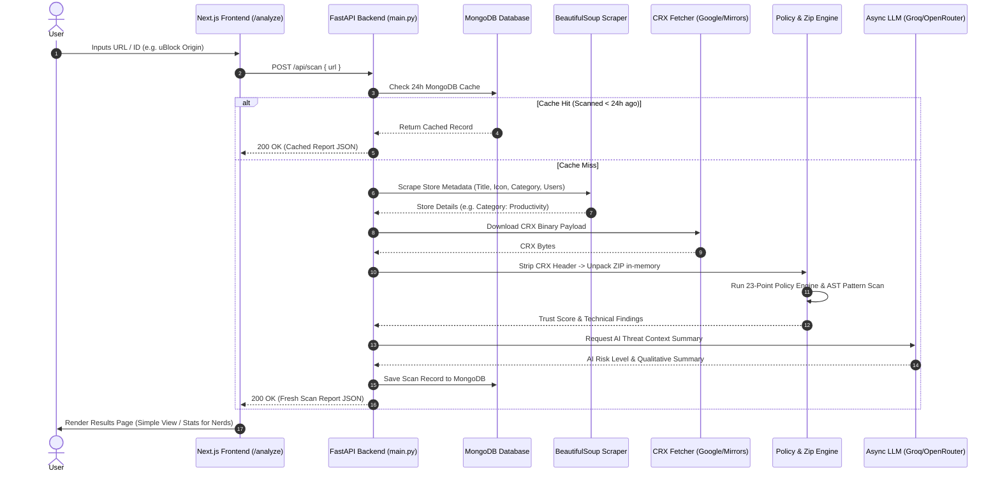

# 🔒 Safex: Full-Stack Architecture & Workflow Guide

Welcome to the comprehensive system architecture guide for **Safex**. This document explains how the **Python FastAPI Backend** and **Next.js 15 Frontend** operate together to analyze Chrome extensions for security risks.

---

## 1. Executive Summary & Tech Stack

Safex is an enterprise-grade security application that audits Chrome extensions. It allows users to input a Chrome Web Store URL/ID or upload a `.crx` package to analyze manifest permissions, Content Security Policies (CSP), hidden embedded URLs, and unsafe JavaScript patterns.

```
┌────────────────────────────────────────────────────────────────────────────────────────┐
│                                     SAFEX TECH STACK                                   │
├───────────────────────────┬───────────────────────────┬────────────────────────────────┤
│  Frontend Layer           │  Backend Layer            │  Database & Infrastructure     │
├───────────────────────────┼───────────────────────────┼────────────────────────────────┤
│  • Next.js 15 App Router  │  • Python 3.11 / 3.13     │  • MongoDB (Motor Async ODM)   │
│  • React 19 + TypeScript  │  • FastAPI + Uvicorn      │  • Docker & Docker Compose     │
│  • Tailwind CSS v4        │  • Pydantic v2 Settings   │  • Render (Backend Hosting)    │
│  • Lucide Icons           │  • BeautifulSoup4 Scraper │  • Vercel (Frontend Hosting)   │
│  • Light / Dark Theme     │  • Async HTTPX & LLM      │  • OpenAI-Compatible LLM APIs  │
└───────────────────────────┴───────────────────────────┴────────────────────────────────┘
```

---

## 2. End-to-End System Workflow (Mermaid Sequence)

Here is how data flows through the application from the user's browser down to the analysis engine and database:



---

## 3. Deep-Dive Backend Architecture (`/backend/app`)

The Python backend is structured using clean service-oriented principles:

```
backend/
├── app/
│   ├── main.py                # FastAPI app lifecycle, CORS, rate limiting, routes
│   ├── core/
│   │   └── config.py          # Pydantic environment configuration
│   ├── db/
│   │   └── database.py        # Async Motor MongoDB connection & index manager
│   ├── services/
│   │   ├── crx_fetcher.py     # ID parser & async CRX downloader (Google/Mirrors)
│   │   ├── store_scraper.py   # BeautifulSoup Web Store HTML metadata parser
│   │   ├── analyzer.py        # CRX header stripper, zipfile extractor & URL miner
│   │   ├── policy_engine.py   # 23-Point permission audit & calibrated scoring rules
│   │   ├── ai_analyzer.py     # Provider-agnostic LLM threat contextualizer
│   │   └── formatter.py       # Human-readable findings report formatter
│   └── api/
│       ├── schemas.py         # Request/Response Pydantic schemas
│       └── endpoints/
│           ├── scan.py        # POST /api/scan
│           ├── upload.py      # POST /api/upload
│           └── dashboard.py   # GET /api/dashboard/history & /stats
└── tests/
    └── test_policy_engine.py  # Pytest automated test suite
```

---

## 4. Deep-Dive Frontend Architecture (`/frontend/cyber_trust/app`)

The frontend is built with **Next.js 15 App Router**, **TypeScript**, and **Tailwind CSS v4**.

```
frontend/cyber_trust/app/
├── globals.css               # Design tokens & Light/Dark theme CSS variables
├── layout.tsx                # Root layout with ThemeProvider & Navbar/Footer
├── page.tsx                  # Marketing Landing Page
├── analyze/
│   └── page.tsx              # Dedicated Extension Analyzer
├── checklist/
│   └── page.tsx              # Interactive 23-Point Security Specification
├── dashboard/
│   └── page.tsx              # Analytics Dashboard & Paginated History Log
├── results/[id]/
│   └── page.tsx              # Dual-Mode Results View (Simple vs Stats for Nerds)
├── components/
│   ├── Navbar.tsx            # Navigation bar + Theme Toggle
│   ├── Footer.tsx            # Footer component
│   └── ClientOnly.tsx        # Hydration wrapper preventing browser extension errors
└── context/
    └── ThemeContext.tsx      # Light & Dark theme state provider
```

---

## 5. Local Testing Instructions

To run both services on your machine simultaneously:

```bash
# Terminal 1 — Python FastAPI Backend
cd backend
.\.venv\Scripts\Activate.ps1
python -m uvicorn app.main:app --port 4001 --reload

# Terminal 2 — Next.js Frontend
cd frontend/cyber_trust
npm run dev
```

Visit **http://localhost:3000** to run analyses!
